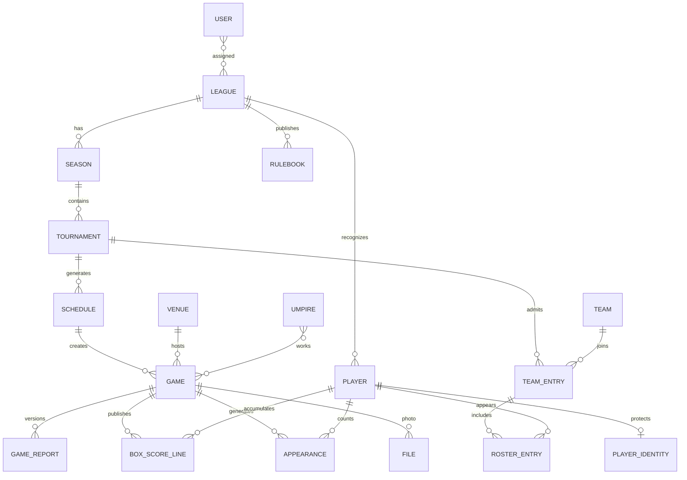

# Data model

MongoDB. Everything is **[P]** unless marked **[D]**. Collection, field and value names are in English
[D]; see the [glossary](../glossary.md).

## Hierarchy

**League** → **Season** (2026) → **Tournament** (Aluminum 2026) → **TeamEntry** → **RosterEntry** and **Game**

- The category is a field of the tournament.
- **[D]** A CURP can be on only one team per tournament.
- Playing two tournaments of the same season (Aluminum and Wood) is allowed for now. It is the optional
  rule `oneCategoryPerSeason`; when enabled, the service checks it on registration, because an index
  cannot depend on configuration.
- The `Player` is unique in the league, so the board can verify claims across tournaments.

## Collections

All of them carry `leagueId` (except `leagues` and `users`), `createdAt` and `updatedAt`.
In the generic base, the league is an `organization` and user roles are memberships
`{ organizationId, role, scope? }` ([ADR 0004](../decisions/0004-generic-domain-boundary.md)).

### Organization

| Collection    | Main fields                                                                                                                                        |
| ------------- | -------------------------------------------------------------------------------------------------------------------------------------------------- |
| `leagues`     | name, slug, logo, timeZone                                                                                                                         |
| `seasons`     | name, startsOn, endsOn, status                                                                                                                     |
| `tournaments` | seasonId, name, category, sport, status, **settings**                                                                                              |
| `schedules`   | tournamentId, format, rounds, groups[{name, teamEntryIds[]}], dates, slots[{venueId, weekday, times}], blackoutDates[], status (draft / published) |
| `rulebooks`   | tournamentId (optional), title, version, effectiveFrom, content or fileId, published                                                               |

`tournaments.settings`: `minAppearances` (5) · `oneCategoryPerSeason` (false) · `rainMinInnings` ·
`innings` · `rosterDeadline` {days, time} · `transfersPerPlayer` (0) · `forfeitRuns` (9) · `forfeitCredit`
(true) · `standingsTiebreakers[]` · `gameTiebreak` {method: extraInnings / coinToss /
extraInningsThenCoin, maxExtraInnings} · `changeHistory[]`.

### Teams and players

| Collection         | Main fields                                                                                                                                          |
| ------------------ | ---------------------------------------------------------------------------------------------------------------------------------------------------- |
| `teams`            | name, slug, colors, logo                                                                                                                             |
| `teamEntries`      | tournamentId, teamId, joinedOn, withdrawnOn, status (active / disqualified)                                                                          |
| `players`          | firstName, lastName, normalizedName, bats, throws, photoId, photoConsent, mergedInto                                                                 |
| `playerIdentities` | playerId, curpEncrypted, curpHash, noticeVersion, noticeAcceptedAt, exception {reason, by}                                                           |
| `privacyNotices`   | version, text, effectiveFrom                                                                                                                         |
| `rosterEntries`    | seasonId, tournamentId, teamEntryId, playerId, number, positions[], status, active, proposedAt, proposedBy, resolvedAt, resolvedBy, reason, from, to |

- `rosterEntries.status`: `provisional` / `proposed` / `approved` / `rejected` / `released`.
- `active` is true for `proposed` and `approved`, false otherwise.
- `playerIdentities` is a separate collection so no ordinary query loads the CURP.

### Games

| Collection      | Main fields                                                                                                                                                                                               |
| --------------- | --------------------------------------------------------------------------------------------------------------------------------------------------------------------------------------------------------- |
| `venues`        | name, address, location, active                                                                                                                                                                           |
| `umpires`       | name, active                                                                                                                                                                                              |
| `games`         | tournamentId, scheduleId, group, round, matchday, startsAt, venueId, homeEntryId, awayEntryId, umpires[{umpireId, position}], scorerId, status, **result**, rosterDeadlineAt, rosterReview, replaysGameId |
| `gameReports`   | gameId, version, source (manual / ai), level (quick / full), status, linescore, lines[], photos[], submittedBy, reviewComment                                                                             |
| `boxScoreLines` | gameId, tournamentId, playerId, rosterEntryId, teamEntryId, number, battingOrder, positions[], ineligible, **batting**, **pitching**                                                                      |
| `appearances`   | tournamentId, gameId, playerId, teamEntryId, type (scoresheet / lineup / credit), reason, by                                                                                                              |
| `gameIssues`    | gameId, authorId, text, status, response                                                                                                                                                                  |
| `files`         | kind, storageKey, size, visibility, uploadedBy                                                                                                                                                            |
| `auditLogs`     | actorId, action, entity, entityId, before, after, reason, at                                                                                                                                              |

- `games.status`: `scheduled` / `submitted` / `inReview` / `published` / `postponed` / `suspended` / `cancelled`.
- `games.result`: type, homeRuns, awayRuns, winnerEntryId, inningsPlayed, offenderEntryId, decidedBy, reason.
- `result.type`: `regular` / `rainShortened` / `forfeitedByOffense` / `forfeit` / `doubleForfeit` / `voided`. No ties [D].
- `result.tiebreak`: method (`extraInnings` / `coinToss`), decidedBy, reason.
- `batting`: PA, AB, R, H, 2B, 3B, HR, RBI, BB, HBP, SO, SH, SF, SB, CS (in code with full names:
  `plateAppearances`, `atBats`…, see [naming](../standards/naming.md)).
- `pitching`: **outs**, H, R, ER, BB, HBP, SO, HR, decision. Outs are stored instead of decimal innings.
- `batting` and `pitching` are empty in a quick capture.
- The audit log never contains a CURP, not even encrypted.

## Indexes that protect rules

| Rule                         | Unique index                                                            |
| ---------------------------- | ----------------------------------------------------------------------- |
| CURP unique in the league    | `playerIdentities {leagueId, curpHash}`, partial when `curpHash` exists |
| One team per tournament [D]  | `rosterEntries {tournamentId, playerId}`, partial `active: true`        |
| Unique number in the team    | `rosterEntries {teamEntryId, number}`, partial `status: approved`       |
| Team registered once         | `teamEntries {tournamentId, teamId}`                                    |
| One line per player and game | `boxScoreLines {gameId, playerId}`                                      |
| One appearance per game      | `appearances {gameId, playerId}`                                        |
| Capture version              | `gameReports {gameId, version}`                                         |
| Unique email                 | `users {email}`                                                         |

## Computed, not stored

- **Standings:** from published games, ordered by winning percentage (PCT) and tie-breakers. Runs of a
  9-0 forfeit do not count in tie-breakers [D].
- **Appearance counter:** number of `appearances` of the player in the tournament, credits (`credit`) shown apart.
- **Eligibility:** counter ≥ `minAppearances` with an approved roster entry, or a recorded exception.
- **Leaders and averages:** sum of `boxScoreLines`, with the number of games with a full capture.

If any of these gets slow, add a cache that can be regenerated.

## Operations in a transaction

1. **Publish:** approved capture → `boxScoreLines` + `appearances` + result + audit log.
2. **Correct a published game:** new capture version; replaces that game's lines and appearances.
3. **Withdraw a team:** entry `disqualified`, roster entries `released`, pending games `cancelled`. Played games do not change.
4. **Merge players:** moves roster entries, lines and appearances; if both appear in the same game it stops and the board decides.
5. **Forfeit by offense:** result 9-0, the player is marked `ineligible`; their lines are kept but excluded from totals, and their appearance removed.
6. **Forfeit (no show):** `lineup` appearances + `credit` to the rest of the roster as it was before the game.

## Cases checked against the rules

| Case                                       | How it is handled                                                                              |
| ------------------------------------------ | ---------------------------------------------------------------------------------------------- |
| Occasional player                          | `provisional` roster entry created on capture; normal line and appearance                      |
| Tuesday deadline                           | `games.rosterDeadlineAt`; when it passes, `rosterReview = possiblyIneligible`                  |
| Extension or exception                     | New deadline or a decision with reason in the audit log                                        |
| Player freed when the team withdraws       | Roster entry no longer `active`; can register elsewhere and keeps appearances                  |
| Lower the minimum                          | Change `settings.minAppearances`; eligibility is recomputed                                    |
| Tie                                        | Cannot be published without `result.tiebreak`                                                  |
| Generate schedule                          | Draft in `schedules`; publishing creates `games`                                               |
| Regenerate                                 | Only future games without a result                                                             |
| Not enough innings in rain                 | Result `voided`; new game with `replaysGameId`                                                 |
| Nobody shows up                            | `doubleForfeit` (both lose) or a new game with `replaysGameId`; no appearances                 |
| Claim about a player in another tournament | The board searches by CURP in the league and sees active roster entries; the search is audited |
| Number changed                             | The number used stays on the game line                                                         |
| Future AI                                  | `gameReports.source = ai`; nothing else changes                                                |

## Size

Assumption: 120 games × 40 lines × ~0.5 KB ≈ 2.4 MB of lines per season, plus appearances, captures and
indexes. It fits easily in Atlas' free 0.5 GB; photos are stored outside the database.

## Decisions

- CURP unique per tournament to register; player unique in the league to recognize the person.
- **[D]** A provisional player never regularized: appearance visible, not eligible until approved.
